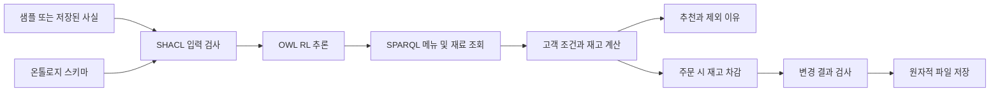
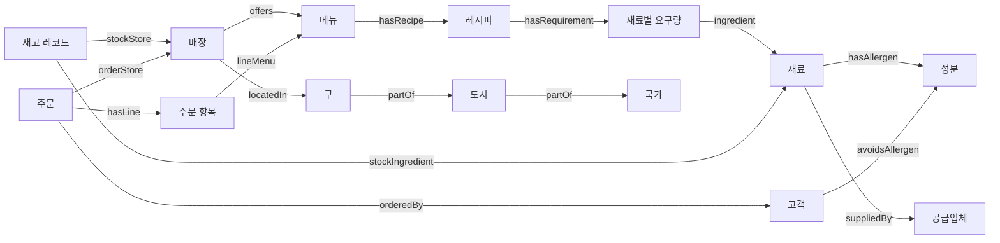

# 고급 응용과 복잡한 온톨로지

이 예제에서는 단순히 추론 전후의 문장 수를 비교하는 대신, 온톨로지에서 얻은
정보를 추천·재고 계산·주문 저장에 사용합니다. 실행 명령은 저장소 루트 기준입니다.

## 실행 흐름



조회는 읽기 전용입니다. 주문은 잠금 안에서 데이터 읽기부터 저장까지 수행합니다.
추론 결과는 메모리에서 사용하고, 저장 파일에는 변경된 사실과 주문만 기록합니다.

## 온톨로지 구조



관계에 붙은 값이 필요할 때는 별도 개체를 만듭니다. 예를 들어 메뉴와 재료 사이에
곧바로 18g을 붙이기보다, `RecipeRequirement`에 재료와 사용량을 기록합니다.
재고도 재료 자체의 값이 아니라 매장/재료 조합의 `StockEntry`에 저장합니다.

## 새로운 추론 기능

### 1. 서로 다른 관계를 연결하는 속성 체인

```turtle
ex:containsIngredient owl:propertyChainAxiom (
    ex:hasRecipe ex:hasRequirement ex:ingredient
) .
```

메뉴에서 레시피, 요구량, 재료까지의 세 관계를 읽어 메뉴의 직접 재료 연결을 만듭니다.
같은 관계를 반복하는 추이성과 달리, 서로 다른 관계들을 연결합니다.

```turtle
ex:containsAllergen owl:propertyChainAxiom (
    ex:containsIngredient ex:hasAllergen
) .
```

메뉴의 성분을 메뉴마다 다시 입력하지 않아도 재료의 성분으로부터 알아낼 수 있습니다.
`menuSuppliedBy`도 같은 원리로 메뉴의 공급업체를 연결합니다.

### 2. 값과 존재 조건으로 클래스 정의

`CaffeinatedIngredient`는 `Ingredient`이면서 `ingredientCaffeine=true`인 대상으로
정의했습니다. `CaffeinatedMenu`는 `MenuItem`이면서 카페인 재료를 하나 이상 포함하는
대상입니다. 후자는 `someValuesFrom`을 사용합니다.

샘플 데이터에는 원두의 카페인 값만 들어 있고, 원두나 아메리카노에 카페인 클래스
타입을 직접 붙이지 않았습니다. 추론기가 재료 클래스와 메뉴 클래스를 차례로 분류합니다.

### 3. 지역과 공급망 모델

- `CoffeeDrink → Beverage → MenuItem`은 클래스 계층입니다.
- `partOf`는 지역 간 추이적 관계입니다.
- `locatedIn → inRegion`은 속성 계층입니다.
- `locatedIn + partOf → inRegion` 체인은 매장의 상위 지역을 얻습니다.
- `suppliedBy`와 `suppliesIngredient`는 서로 역관계입니다.
- `orderedBy`와 `placedOrder`는 주문 방향을 바꾸어 조회할 수 있게 합니다.

## OWL, SHACL, Python의 역할

| 도구 | 맡은 역할 |
|---|---|
| OWL | 클래스와 관계 의미, 재료·성분·공급망 연결 추론 |
| SHACL | 필수값, 자료형, 양수 사용량, 음수/중복 재고 검사 |
| SPARQL | 메뉴의 레시피와 공급업체 영향 조회 |
| Python | 총가격·사용량 계산, 정책 적용, 제외 이유, 재고 차감, 저장 |

OWL이 재고 산술이나 파일 트랜잭션을 자동으로 수행하지는 않습니다.
조건에 맞는 메뉴를 얻는 데 필요한 의미를 OWL로 선언하고 실제 처리 흐름을 Python으로
구현합니다. `shapes.ttl`의 중복 재고 검사는 SHACL-SPARQL 제약을 사용합니다.

## 직접 바꾸어볼 세 가지 실습

먼저 `advanced_cafe.py demo`로 원본 샘플을 확인하세요. `demo`는 저장된 상태를 읽지
않으므로 아래와 같이 샘플 파일을 바꾸었을 때 결과를 비교하기 좋습니다.

1. **재료 성분 전파:** `sample_data.ttl`의 `OatMilk`에
   `ex:hasAllergen ex:MilkAllergen`을 추가하세요. 귀리 라테가 민수에게 제외되어야 합니다.
   귀리 라테 자체나 Python 코드에 우유 성분을 추가할 필요가 없습니다.
2. **재고와 조건 비교:** `StockMatcha`의 0g을 20g으로 바꾸세요. 민수의 말차 라테는
   조건 일치가 되지만 지수에게는 카페인 조건 때문에 계속 제외됩니다.
3. **입력 검사:** `StockCoffee`의 재고를 -1g으로 바꾸세요. 추천 전에 SHACL 검사가
   실패해야 합니다. 이후 샘플을 원래 값으로 되돌리세요.

이미 저장된 상태를 사용하는 `recommend`나 `order`에서는 샘플 수정이 반영되지 않습니다.
새 `--state` 경로를 지정하면 수정한 샘플로 새 실습 세션을 시작할 수 있습니다.

## 주문 처리와 한계

```powershell
.\.venv\Scripts\python.exe ontology_practice\src\ontology_practice\advanced_cafe.py order --menu OatLatte --state outputs/lesson-order.ttl
```

주문은 UUID 기반 IRI로 식별하고 생성 시각은 UTC `xsd:dateTime`으로 저장합니다.
총액은 주문 시점 단가와 수량을 사용합니다. 레시피에 같은 재료가 여러 줄 있으면 합산합니다.
재고 부족이나 정책 불일치는 모두 저장 전에 처리하며, 변경 후 다시 SHACL 검사를 수행합니다.

잠금 파일은 상태 파일 옆에 `.lock` 확장자로 생성합니다. 다른 프로세스가 잠금을 갖고
있으면 명령이 실패하고 재시도를 안내합니다. 프로세스가 강제 종료되면 잠금 파일이 남을
수 있으므로 해당 프로세스가 종료되었음을 확인한 뒤 잠금 파일을 직접 정리해야 합니다.
자동 잠금 만료나 분산 서버의 트랜잭션 처리는 포함하지 않습니다.

재료 프로필은 실습 데이터 안에서 완전한 목록이라고 가정하며 `profileComplete=true`로
표시합니다. 이 표시가 실제 제품 정보의 정확성을 증명하는 것은 아닙니다.
식물성 여부는 값으로 검사하고, 알레르기 성분의 부재를 OWL의 논리적 부정으로 추론하지 않습니다.

## 읽는 순서

1. [요구사항](REQUIREMENTS.md)의 완료 시나리오를 읽습니다.
2. [ontology.ttl](ontology.ttl)의 속성 체인과 클래스 조건을 살펴봅니다.
3. [sample_data.ttl](sample_data.ttl)의 아메리카노 레시피를 따라갑니다.
4. [shapes.ttl](shapes.ttl)의 재고 중복 제약을 읽습니다.
5. [응용 코드](../src/ontology_practice/advanced_cafe.py)의 `prepare`, `recommend`, `place_order`를 읽습니다.
6. [테스트](../tests/test_advanced_cafe.py)에서 거절 시 상태 보존을 확인합니다.

## 참고

- [OWL 2 속성 체인](https://www.w3.org/TR/owl2-primer/#Property_Chains)
- [OWL 2 클래스 제한](https://www.w3.org/TR/owl2-primer/#Property_Restrictions)
- [SHACL](https://www.w3.org/TR/shacl/)
- [pySHACL](https://github.com/RDFLib/pySHACL)
